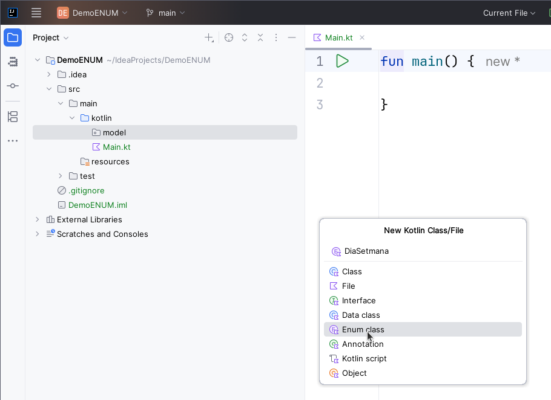
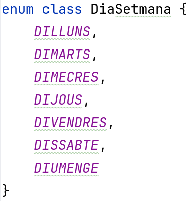
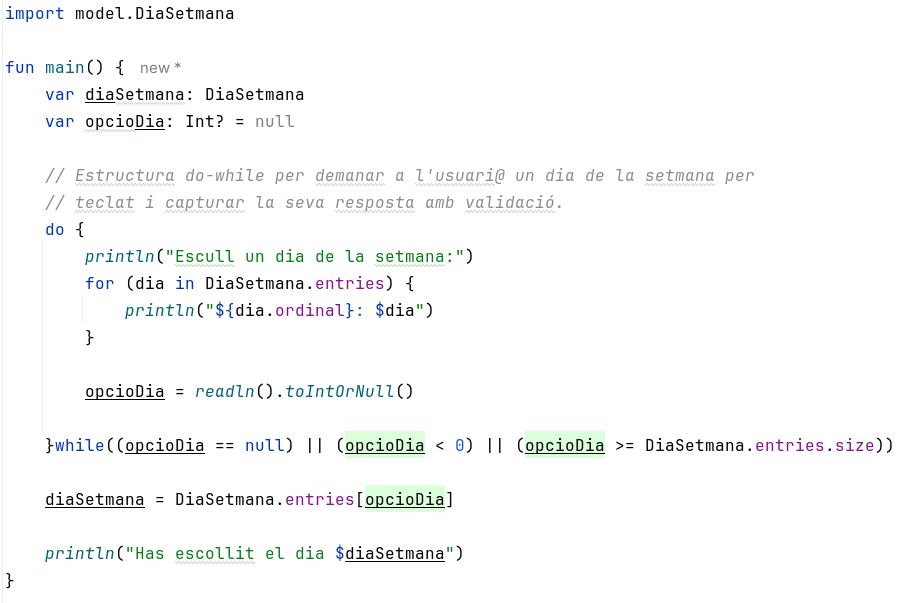
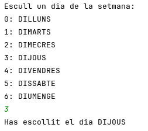

# Objectiu de repositori
Aquest repositori té com a objectiu fer una introducció a l'ús d'estructures **ENUM** en Kotlin.

# Captures de pantalla
## Crear estructura enum
Crearem les estructures enum dins del package `models`

## Codi font `DiaSetmana`

## Crida dins de `Main`

## Sortida per pantalla

# Codi font
El podem trobar [aquí](src/main/kotlin/Main.kt)